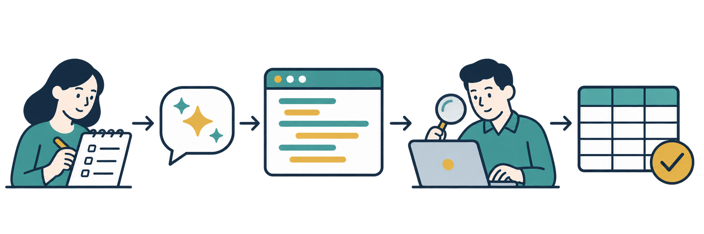

Generative AI tools, such as chatbots and code assistants, can turn a written request into a draft R script. They can also explain functions, suggest changes, and help users understand error messages. These features may support learning and routine data-analysis tasks. However, generated code can be incorrect or may not fit the research question. In a recent study of statistical coding tasks, ChatGPT produced accurate R code for many tasks, but the researchers also found errors in data management and figures. They concluded that users still need to check and revise the output [@Winberg2026]. Research focused on R also shows that model performance can vary across tasks and between common R coding styles [@ZhaoFard2025]. This handout presents a practical way to use NextGenAI as a coding assistant: explain the task clearly, run the suggested code, check the results, and understand the final script.

{#fig-ai-workflow fig-alt="A diagram showing task definition, an AI suggestion, human review of code, execution in R, and verification of the result."}

# How NextGenAI Can Support R Coding

NextGenAI can support different parts of R programming. A user can ask it to draft a short script, explain an unfamiliar function, or suggest how to fix an error message. It can also help improve comments and make code easier to read. This can be useful when a student is learning a new package or does not know how to begin a task. In a small study with 24 programmers, AI-supported programming improved some productivity measures. However, the study used Python tasks, so its results do not prove that AI will improve every R task [@Weber2024]. The user still needs to understand the goal and decide whether the suggested code is suitable.

## A Human-Checked Workflow

A safe workflow keeps the user responsible for the final code. First, describe the goal, the data, and the expected result. Ask the AI for a small, commented R example and request an explanation of each step. Read the code before running it. Then run it in R and check whether the output makes sense. For example, check the number of rows, missing values, variable names, and summary results. If an error occurs, share the exact error message and the relevant code, then review the suggested correction. Do not share private or confidential data in a prompt. Research on test-guided code generation found that tests can help users judge AI-generated code more accurately, although the study’s programming tasks were mainly in Python [@Fakhoury2024]. The same careful checking is useful when working with R.

## Example: Summarising Data in R

The following example shows how NextGenAI can help with a simple data task. A user can ask: “Write base R code to calculate the average miles per gallon (mpg) for each cylinder group in the built-in mtcars dataset. Add comments and explain the code.” The suggested code should be run and checked before it is used.

```{r}
#| label: fig-mpg-by-cylinder
#| fig-cap: "Mean miles per gallon by cylinder group."
#| fig-alt: "Bar chart showing mean miles per gallon for four-, six-, and eight-cylinder cars."
#| echo: true

# Calculate the average mpg for each cylinder group
average_mpg <- aggregate(mpg ~ cyl, data = mtcars, FUN = mean)

average_mpg
# Verify the averages with a second base R function
tapply(mtcars$mpg, mtcars$cyl, mean)


```

The formula `mpg ~ cyl` tells R to calculate the average miles per gallon for each cylinder group. The `data = mtcars` part identifies the dataset, and `FUN = mean` asks R to calculate the mean. The results show averages of about 26.66 mpg for four-cylinder cars, 19.74 mpg for six-cylinder cars, and 15.10 mpg for eight-cylinder cars. The `tapply()` function checks these averages using another base R method. Matching results are a useful check, although they do not prove that every part of the analysis is correct.

## Limitations and Responsible Use

AI-generated code is a suggestion, not proof that an analysis is correct. It may contain bugs, use the wrong variable names, or make assumptions that do not fit the data. In one study of statistical coding, researchers found errors in data management and figures, and the generated code varied between users and sessions [@Winberg2026]. Research focused on R also found that model performance can vary with the task and coding style [@ZhaoFard2025]. These studies do not mean that every AI suggestion is wrong. They show why users should run the code, check the output, and compare it with reliable documentation. Users should also protect private data, understand every line they submit, and follow their lecturer’s rules for acknowledging AI assistance. AI-generated code should support the student’s work, not replace their understanding.

## Classroom Exercise

Work in pairs. Ask NextGenAI to write base R code that calculates the median mpg for each cylinder group in the mtcars dataset. Run the code and check the result with a second R method, such as tapply(). Then explain what the code does and decide whether the output answers the question.

Prompt to try: “Write commented base R code to calculate the median mpg for each cyl group in mtcars. Explain each line and show how I can check the result independently.”

## Conclusion

NextGenAI can help users draft, explain, and revise R code, but it cannot guarantee that the code or analysis is correct. The example in this handout shows a simple checking process: state the task clearly, run the code, and compare its result with a second method. Research suggests that AI can support coding tasks, while human review remains necessary [@Fakhoury2024; @Winberg2026]. Used carefully, NextGenAI can support learning and routine programming, while the user remains responsible for understanding and checking the final code. \newpage

## Affidavit

I hereby affirm that this submitted paper was authored unaided and solely by me. Additionally, no other sources than those in the reference list were used. Parts of this paper, including tables and figures, that have been taken either verbatim or analogously from other works have in each case been properly cited with regard to their origin and authorship. This paper either in parts or in its entirety, be it in the same or similar form, has not been submitted to any other examination board and has not been published.

I acknowledge that the university may use plagiarism detection software to check my thesis. I agree to cooperate with any investigation of suspected plagiarism and to provide any additional information or evidence requested by the university.

Checklist:

- [x] My handout contains 3-5 pages of text (The front page, the affidavit, and the reference list do not count).

- [x] My submission contains the Quarto file of the handout.

- [x] My submission contains the Quarto file of the presentation.

- [x] My submission contains the HTML file of the handout.

- [x] My submission contains the HTML file of the presentation.

- [x] My submission contains the PDF file of the handout.

- [x] My submission contains the PDF file of the presentation.

- [x] The title page of my presentation and handout contain personal details (name, email, matriculation number).

- [x] My handout contains a bibliography, created using BibTeX with an APA citation style.

- [x] Either the handout or the presentation contains R code that verifies my expertise in coding.

- [x] The Affidavit is filled out correctly.

- [x] The PDF and HTML files of the presentation and the handout are published on GitHub Pages.

- [x] I submitted a pull request to the repository <https://github.com/hubchev/make_a_pull_request>, where I added my GitHub username and the repository related to this submission to the file <https://github.com/hubchev/make_a_pull_request/dadm_ws26.md>.

Zahra Azimi Khalegh,25.11,2026,Cologne
